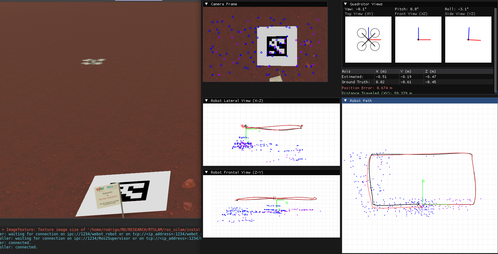

# EKF-MonoSLAM Aided by Range-to-Base Measurements

C++ ROS 2 implementation of the SLAM approach described in:

**“UAV Navigation Using EKF-MonoSLAM Aided by Range-to-Base Measurements”**  
https://doi.org/10.3390/drones9080570



This repository is a **standalone research / simulation stack**. It is
**independent of the UAV accelerator** project.

## Tested environment

| Item | Version |
|---|---|
| OS | Ubuntu 24.04 |
| ROS 2 | Jazzy |
| Webots | R2025a |
| Viewer (default) | Plot2 (ImGui / GLFW) |
| Viewer (optional) | RViz2 |

Older README notes mentioning Galactic / Webots R2023a describe the upstream
paper baseline, not the current Jazzy bring-up.

## Components

**Composable nodes (app container):** Local SLAM (`EKFslam`), Webots bridge
(`WEBOTb`), Control (`ControlQuad`), optional Plot2.

**Separate processes:** Webots (`webot_package`), operator keyboard, optional
RViz2.

**Also in-tree (not required for the default experiment):** Global SLAM,
dataset playback. The legacy OpenCV **`plot`** package has been **removed**.

## Dependencies

**Required for the integrated experiment**

- ROS 2 Jazzy + `webots_ros2` (`sudo apt-get install ros-jazzy-webots-ros2`)
- Webots R2025a (`WEBOTS_HOME`)
- Armadillo + BLAS/LAPACK
- OpenCV (contrib modules as needed by Local/Global SLAM; **VIZ/VTK not required** after `plot` removal)
- GTSAM 4.2.x (required to build `globalslam`; user prefix via
  `CMAKE_PREFIX_PATH` / `GTSAM_DIR` — see `tools/gtsam_prefix.env.example`)

**Optional**

- `libglfw3-dev` — required only for Plot2
- `ros-jazzy-rviz2` — required only for `--viewer rviz2`
- ImGui sources are vendored under `src/plot2`

**Deferred:** FluidPressure altitude input remains deferred (derived GPS-height
altitude is the default).

## Build (conventional trees)

```bash
cd ~/DEV/projects/EKF-MonoSLAM-Range-To-Base
source /opt/ros/jazzy/setup.bash
# Plot2 needs GLFW headers at build time:
sudo apt-get install libglfw3-dev

colcon build \
  --packages-select interfaces localslam webotbridge control \
    ekf_monoslam_bringup webot_package plot2 keyboard \
  --build-base build --install-base install
```

Standalone Local SLAM only:

```bash
colcon build --packages-select interfaces localslam \
  --build-base build --install-base install
```

Global SLAM (requires GTSAM 4.2.x on `CMAKE_PREFIX_PATH`; not in `./launch2.sh`):

```bash
# set -a && source tools/gtsam_prefix.env && set +a   # see .env.example
colcon build --packages-select interfaces globalslam \
  --build-base build --install-base install
source install/setup.bash
ros2 launch globalslam globalslam.launch.py   # works from /tmp
```

Normal `globalslam` builds **fail** if GTSAM is missing. Policy-unit-tests only
(no component): `--cmake-args -DGLOBALSLAM_POLICY_TESTS_ONLY=ON`.

Override the install prefix with `EKF_INSTALL_BASE` if needed (default for
`./launch2.sh` is `install/`).

## One-command integrated launch

Two quadrotor LocalSLAM profiles:

| Launcher | Default YAML | Range | LocalSLAM mode |
|---|---|---|---|
| `./launch2.sh` | `config/quad_params.yaml` | Sonar | **Velocity-aided** (`Speed_update: true`, `min_vel: 0.1`, `Sigma_a: 6`, `Sigma_cam_uv: 10`) |
| `./launch3.sh` | `config/quad_params_no_velocity.yaml` | Sonar | **Velocity-free optimized** (`Speed_update: false`, `min_vel: -1`, `Sigma_a: 4`, `Sigma_cam_uv: 10`) |
| `./launch4.sh` | `config/quad_params_no_velocity_tfa300l.yaml` | TFA300-L | **Laser + velocity-free** (T2 velocity keys + laser gates/confidence; altitude→depth fallback off) |

`launch3.sh` / `launch4.sh` reuse `launch2.sh`. Explicit `--params-file` / `--range-sensor` override defaults. Velocity-aided production tuning is unchanged. Evidence: [`docs/evidence/lslam_nov_vel_t2/`](docs/evidence/lslam_nov_vel_t2/), [`docs/evidence/lslam_range_b4/`](docs/evidence/lslam_range_b4/).

```bash
source /opt/ros/jazzy/setup.bash
source install/setup.bash
./launch2.sh                         # velocity-aided baseline (sonar range)
./launch3.sh                         # optimized velocity-free LocalSLAM (sonar)
./launch4.sh                         # velocity-free + TFA300-L laser (B4 profile)
./launch4.sh --world earth_aerial.wbt  # B4 laser profile in ENV-A1 Earth-like world
./launch2.sh --range-sensor tfa300l  # velocity-aided + TFA300-L laser
./launch3.sh --range-sensor tfa300l  # velocity-free + TFA300-L laser (gates overlay only)
./launch3.sh --globalslam false --viewer plot2
./launch2.sh --params-file "$PWD/config/quad_params_no_velocity.yaml"  # same as launch3 default
# equivalents / options (apply to launch2, launch3, or launch4):
./launch2.sh --viewer plot2
./launch2.sh --viewer rviz2
./launch2.sh --viewer none
./launch2.sh --slam-feedback false   # Stage A: GT GPS control feedback
./launch2.sh --globalslam true       # Global Path/cloud; Local feedback still off
# G6d: BA feedback off + tag-loop Local feedback on (coordinated):
./launch2.sh --globalslam true \
  --apply-ba-corrections false --apply-tag-loop-corrections true \
  --slam-feedback false
# Compatibility master (forces Apply_* for each enabled source; never enables visual):
./launch2.sh --globalslam true --global-corrections true --slam-feedback false
./launch2.sh --globalslam true --global-corrections true \
  --slam-feedback true --slam-feedback-interface odometry \
  --control-plan "$(pwd)/control_plan_g6b.txt"
```

Starts **one** Webots, **one** application container, **one** chosen viewer
(or none), plus an operator terminal. Status/logs stay in the launching
terminal. Ctrl-C cleans up launcher-owned processes.

G6d: `Enable_*` / `Apply_*` are independent per source (BA, tag loop, visual
ORB/PnP). All `Apply_*` default **false**. `--global-corrections true` is a
compatibility master that forces `Apply_*` only for enabled sources and forces
`Coordinate_mode=required` (no absent_ok/offline_bypass). It does **not**
silently enable visual-loop processing. `--slam-feedback` selects Control nav
pose source only — it is **not** Local correction enablement. See
[`docs/evidence/g6b/G6d_CLOSEOUT.md`](docs/evidence/g6b/G6d_CLOSEOUT.md).

Viewer differences: see [`docs/viewers.md`](docs/viewers.md).

## Operator controls

In the **EKF-Operator** terminal:

| Key | Action |
|---|---|
| `a` | **Start / stop the control plan** (`control_plan.txt`) |
| `s` | Enable / disable Local SLAM (`/EKFslam/enable`; visual on start) |
| `w` | Coordinated reset (`/EKFslam/reset` + control; clear Plot2 if present) |
| `t` | Takeoff / land |
| `q` | Quit operator |
| flight keys | `r/f/d/g` translate, `i/k` up/down, `j/l` yaw, space stop |

Plot2-only keys (`-/+`, `1`–`3`, pan `4/5/6/8`, `7` clear, `9` screenshot) are
active only when `--viewer plot2`. Under RViz2, use RViz’s own navigation UI.

## Configuration

| Source | Role |
|---|---|
| `config/quad_params.yaml` | **Authoritative** experiment parameters |
| `control_plan.txt` | Default mission plan (installed with bringup) |
| `config/mobile_params.yaml`, `omni_params.yaml` | Alternate platforms |

Installed copies live under
`install/ekf_monoslam_bringup/share/ekf_monoslam_bringup/`. After editing
`config/` or `control_plan.txt`, **rebuild/reinstall `ekf_monoslam_bringup`**
so the share tree updates (do not maintain a second conflicting copy by hand).

### LocalSLAM range acceptance (B2–B4) and sensor selection

Under `/lslam` (metres; exclusive bounds; sonar defaults unless noted):

| Parameter | Sonar default | Laser (`launch4`) | Semantics |
|---|---:|---:|---|
| `Range_assoc_min_m` | 0.4 | 0.1 | Accept range iff `min < r < max` |
| `Range_assoc_max_m` | 6.0 | 150.0 | Upper exclusive association limit |
| `Range_init_min_m` | 0.5 | 0.5 | `undelayed_range` init iff `r > Range_init_min_m` |
| `Range_allow_altitude_fallback` | true | false | Altitude→`FRAME.range` for init only |
| `Range_sensor_max_*` / `Sigma_cam_initial_depth_*` | sonar beam model | provisional confidence aperture | σ class only — not feature eligibility |

`--range-sensor sonar` remaps `~/downward_range` → `/downward_range` (`ds0`).
`--range-sensor tfa300l` remaps to `/laser_range` and merges gate overlay
[`config/range_sensor_tfa300l.yaml`](config/range_sensor_tfa300l.yaml)
without changing velocity/`Sigma_a`/`Sigma_cam_uv`. Full laser confidence +
fallback-off profile: [`config/quad_params_no_velocity_tfa300l.yaml`](config/quad_params_no_velocity_tfa300l.yaml)
via `./launch4.sh`. See [`docs/evidence/lslam_range_b4/`](docs/evidence/lslam_range_b4/).

## Standalone Local SLAM

```bash
source install/setup.bash
ros2 launch localslam localslam.launch.py
```

Remap standard inputs (`~/image`, `~/imu`, `~/odometry`, …) as documented in
`docs/history/A7_localslam_standalone.md`.

## Interfaces (summary)

**Standard (preferred):** `nav_msgs/Odometry` `/odometry`, `nav_msgs/Path`
`/EKFslam/path`, `sensor_msgs/PointCloud2` `/EKFslam/landmarks`, plus remapped
`sensor_msgs` / `mavros_msgs` sensor inputs.

**Custom retained:** `interfaces/Frame`, `interfaces/Lslam`, range-to-base and
related experiment messages; `interfaces/EstimatorReference` (latched Local
SLAM reference epoch for GT adapters).

**Ground truth:** `nav_msgs/Path` `/ground_truth/path` (RViz2) and
`geometry_msgs/PointStamped` `GT_topic` (Plot2) from the same synchronized
Webots→public-odom conversion. Path pose orientation is identity
(unspecified).

## Repository layout

```
config/          experiment YAML (authoritative)
control_plan.txt default plan
launch/          repo-level launch helpers
launch2.sh       velocity-aided integrated entry point
launch3.sh       velocity-free optimized entry point (wraps launch2.sh)
src/             ROS packages + shared common/
docs/            index, viewers, history/, evidence/
tools/           smoke/, audit/, analysis/
figures/         paper graphics
build/ install/ log/   conventional colcon trees (gitignored)
```

## Ground-truth / estimator reference (summary)

Local SLAM publishes latched `~/estimator_reference`
(`interfaces/EstimatorReference`) on init and when altitude home latches;
`valid=false` on reset. The Webots bridge matches GPS history to
`heading_stamp` / `altitude_stamp` (no first-`/odometry` or empty-Path
epoch). Parameters under `/webotbridge` in `config/quad_params.yaml`:
`GT_history_duration_sec`, `GT_match_max_dt_sec`, `GT_path_max_poses`
(values &lt; 1 clamp to 1; **not** unlimited), `GT_path_frame_id`.

Inspect: `ros2 topic echo /ground_truth/path --once` after
`./launch2.sh --viewer rviz2`.

## Known limitations

- Operational smoke checks are **not** accuracy or paper-parity claims.
- Plot2 latest-estimate vs latest-GT error remains **approximate** (no full
  temporal matching of estimator stamps).
- GT Path orientation is unspecified (identity quaternion).
- FluidPressure altitude support is deferred.
- RViz2 does not show Plot2 image overlays or custom statistics.
- Deprecated OpenCV `plot` is removed; do not expect its topic semantics.
- Global SLAM G2–G6d: loadable component; session/epoch KF + correction
  identity; standard Path/cloud; offline `LSposUpdate` apply path; G6a/G6b
  `CorrectionCoordinate` pause/apply/feedback-barrier/release; unique
  `OdometryMeta.snapshot_seq` association for Control acceptance before
  odometry-plan resume; G6d independent `Enable_*`/`Apply_*` and
  `GlobalLoopCommitted` informational event; optional
  `./launch2.sh --globalslam true` with per-source `--apply-*-corrections`
  or master `--global-corrections` (defaults **false**). Pause ack ≠ hover.
  Visual ORB loop exclusive/off-by-default — not mission-claimed without
  candidate evidence. Needs GTSAM 4.2.x via `CMAKE_PREFIX_PATH` /
  `LD_LIBRARY_PATH`. See
  [`docs/history/G1_globalslam_interface_contract.md`](docs/history/G1_globalslam_interface_contract.md)
  and [`docs/evidence/g6b/G6d_CLOSEOUT.md`](docs/evidence/g6b/G6d_CLOSEOUT.md).

More detail: [`docs/README.md`](docs/README.md),
[`docs/history/A9_integrated_launch_plot2.md`](docs/history/A9_integrated_launch_plot2.md),
[`docs/history/G1_globalslam_interface_contract.md`](docs/history/G1_globalslam_interface_contract.md).
