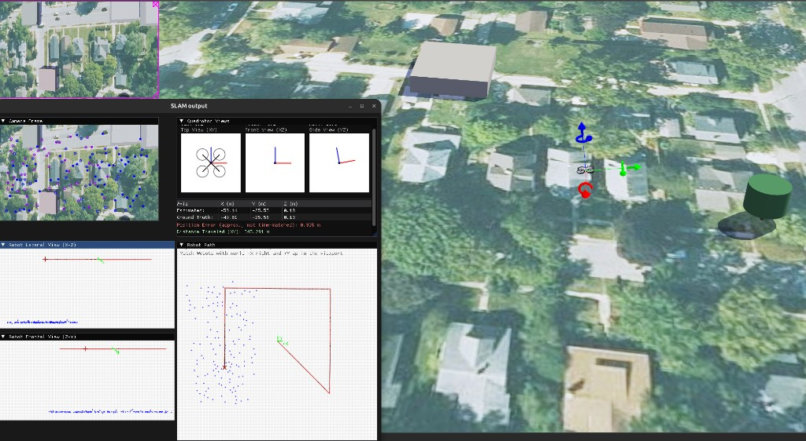

# EKF-MonoSLAM Aided by Range-to-Base Measurements

C++ ROS 2 research / simulation stack for monocular EKF-SLAM on UAVs, with
range-aided landmark initialization and Webots bring-up.

**License:** [MIT](LICENSE)



*Webots `earth_aerial` flight with Plot2: downward camera features, estimated
vs ground-truth pose, and local map / path.*

This repository is a **standalone** stack (independent of the UAV Accelerator
project).

## References

1. R. Munguia, J. C. Trujillo, A. Grau,  
   **UAV navigation using EKF-MonoSLAM aided by range-to-base measurements**,  
   *Drones* 9 (8), 570, 2025.  
   https://doi.org/10.3390/drones9080570

2. R. Munguia, A. Grau, Y. Bolea, G. Obregón-Pulido,  
   **A simultaneous control, localization, and mapping system for UAVs in GPS-denied environments**,  
   *Drones* 9 (1), 69, 2025.  
   https://doi.org/10.3390/drones9010069

3. R. Munguia, J. C. Trujillo, E. Guerra, A. Grau,  
   **A hybrid visual-based SLAM architecture: Local filter-based SLAM with keyframe-based global mapping**,  
   *Sensors* 22 (1), 210, 2022.  
   https://doi.org/10.3390/s22010210

## Tested environment

| Item | Version |
|---|---|
| OS | Ubuntu 24.04 |
| ROS 2 | Jazzy |
| Webots | R2025a |
| Default launcher | `./launch4.sh` |
| Default world | `earth_aerial.wbt` |
| Default viewer | Plot2 (ImGui / GLFW) |
| Optional viewer | RViz2 |

## Components

**Composable nodes (app container):** Local SLAM (`EKFslam`), Webots bridge
(`WEBOTb`), Control (`ControlQuad`), optional Plot2.

**Separate processes:** Webots (`webot_package`), operator keyboard, optional
RViz2.

**Also in-tree (not required for the default experiment):** Global SLAM,
dataset playback.

## Dependencies

**Required for the integrated experiment**

- ROS 2 Jazzy + `webots_ros2`  
  `sudo apt-get install ros-jazzy-webots-ros2`
- Webots R2025a (`WEBOTS_HOME`, typically `/usr/local/webots`)
- Armadillo + BLAS/LAPACK
- OpenCV (contrib as needed by Local/Global SLAM)
- GTSAM 4.2.x only if building `globalslam` (see `tools/gtsam_prefix.env.example`)

**Optional**

- `libglfw3-dev` — required to build Plot2
- `ros-jazzy-rviz2` — only for `--viewer rviz2`

## Installation / build

```bash
cd ~/DEV/projects/EKF-MonoSLAM-Range-To-Base
source /opt/ros/jazzy/setup.bash
sudo apt-get install -y libglfw3-dev ros-jazzy-webots-ros2

colcon build \
  --packages-select interfaces localslam webotbridge control \
    ekf_monoslam_bringup webot_package plot2 keyboard \
  --build-base build --install-base install

source install/setup.bash
```

Standalone Local SLAM only:

```bash
colcon build --packages-select interfaces localslam \
  --build-base build --install-base install
```

Global SLAM (optional; needs GTSAM on `CMAKE_PREFIX_PATH`):

```bash
# set -a && source tools/gtsam_prefix.env && set +a
colcon build --packages-select interfaces globalslam \
  --build-base build --install-base install
```

Override the install prefix with `EKF_INSTALL_BASE` if needed (default:
`install/`).

## Run the simulation (preferred: launch4)

**Default production path** is laser-assisted, velocity-free LocalSLAM
(TFA300-L profile) in the Earth-like world:

```bash
source /opt/ros/jazzy/setup.bash
source install/setup.bash

./launch4.sh --control-plan "$PWD/control_plan.txt"
```

`launch4.sh` defaults:

| Setting | Default |
|---|---|
| World | `earth_aerial.wbt` |
| Params | `config/quad_params_no_velocity_tfa300l.yaml` |
| Range | `tfa300l` (`/laser_range`) |
| Auto-start plan | **off** — start from EKF-Operator |

Equivalent explicit form:

```bash
./launch4.sh \
  --world earth_aerial.wbt \
  --control-plan "$PWD/control_plan.txt"
```

Useful options (forwarded through `launch2.sh`):

```bash
./launch4.sh --viewer plot2          # default Plot2
./launch4.sh --viewer rviz2
./launch4.sh --viewer none
./launch4.sh --slam-feedback false   # GT GPS control feedback (YAML default)
./launch4.sh --auto-start-plan true  # start mission without pressing 'a'
./launch4.sh --globalslam true       # optional Global SLAM
```

### Other launchers

| Launcher | Default YAML | Range | Notes |
|---|---|---|---|
| **`./launch4.sh`** | `quad_params_no_velocity_tfa300l.yaml` | TFA300-L | **Preferred** — laser + velocity-free + `earth_aerial` |
| `./launch3.sh` | `quad_params_no_velocity.yaml` | Sonar | Velocity-free, sonar |
| `./launch2.sh` | `quad_params.yaml` | Sonar | Velocity-aided baseline; default world `mars.wbt` |

```bash
./launch3.sh                         # sonar + velocity-free
./launch2.sh                         # sonar + velocity-aided
./launch2.sh --world earth_aerial.wbt
```

Starts **one** Webots, **one** application container, **one** viewer (or
none), plus an **EKF-Operator** terminal. Status/logs stay in the launching
terminal. Ctrl-C cleans up launcher-owned processes.

Viewer notes: [`docs/viewers.md`](docs/viewers.md).

## Operator controls

In the **EKF-Operator** terminal (plan does **not** auto-start by default):

| Key | Action |
|---|---|
| `a` | **Start / stop the control plan** (`control_plan.txt`) |
| `s` | Enable / disable Local SLAM (`/EKFslam/enable`; visual on start) |
| `w` | Coordinated reset (`/EKFslam/reset` + control; clear Plot2 if present) |
| `t` | Takeoff / land |
| `q` | Quit operator |
| flight keys | `r/f/d/g` translate, `i/k` up/down, `j/l` yaw, space stop |

Plot2-only keys (`-/+`, `1`–`3`, pan `4/5/6/8`, `7` clear, `9` screenshot) are
active only when `--viewer plot2`.

## Configuration

| Source | Role |
|---|---|
| `config/quad_params_no_velocity_tfa300l.yaml` | **Default** for `launch4` (laser + velocity-free) |
| `config/quad_params.yaml` | Velocity-aided sonar baseline (`launch2`) |
| `config/quad_params_no_velocity.yaml` | Velocity-free sonar (`launch3`) |
| `control_plan.txt` | Default mission plan |
| `config/mobile_params.yaml`, `omni_params.yaml` | Alternate platforms |

After editing `config/` or `control_plan.txt`, rebuild/reinstall
`ekf_monoslam_bringup` so the installed share tree updates when you rely on
installed defaults. Absolute `--params-file` / `--control-plan` paths load
source files directly.

### LocalSLAM range acceptance (summary)

| Parameter | Sonar default | Laser (`launch4`) |
|---|---:|---:|
| `Range_assoc_min_m` | 0.4 | 0.1 |
| `Range_assoc_max_m` | 6.0 | 150.0 |
| `Range_init_min_m` | 0.5 | 0.5 |
| `Range_allow_altitude_fallback` | true | false |

See [`docs/evidence/lslam_range_b4/`](docs/evidence/lslam_range_b4/).

## Standalone Local SLAM

```bash
source install/setup.bash
ros2 launch localslam localslam.launch.py
```

Remap standard inputs (`~/image`, `~/imu`, `~/odometry`, …) as in
`docs/history/A7_localslam_standalone.md`.

## Interfaces (summary)

**Standard (preferred):** `nav_msgs/Odometry` `/odometry`, `nav_msgs/Path`
`/EKFslam/path`, `sensor_msgs/PointCloud2` `/EKFslam/landmarks`, plus remapped
`sensor_msgs` / `mavros_msgs` sensor inputs.

**Custom retained:** `interfaces/Frame`, `interfaces/Lslam`, range-to-base and
related experiment messages; `interfaces/EstimatorReference` (latched Local
SLAM reference epoch for GT adapters).

**Ground truth:** `nav_msgs/Path` `/ground_truth/path` (RViz2) and
`geometry_msgs/PointStamped` `GT_topic` (Plot2).

## Repository layout

```
config/          experiment YAML
control_plan.txt default plan
launch4.sh       preferred integrated entry (laser + earth_aerial)
launch3.sh       velocity-free sonar
launch2.sh       velocity-aided / shared backend
src/             ROS packages + shared common/
docs/            index, viewers, history/, evidence/
tools/           smoke/, audit/, analysis/
figures/         graphics used by this README
LICENSE          MIT
build/ install/  conventional colcon trees (gitignored)
```

## Known limitations

- Operational smoke checks are **not** accuracy or paper-parity claims.
- Plot2 latest-estimate vs latest-GT error remains approximate.
- FluidPressure altitude support is deferred (derived GPS-height default).
- Optional Global SLAM needs GTSAM 4.2.x; see
  [`docs/history/G1_globalslam_interface_contract.md`](docs/history/G1_globalslam_interface_contract.md).

More detail: [`docs/README.md`](docs/README.md).
